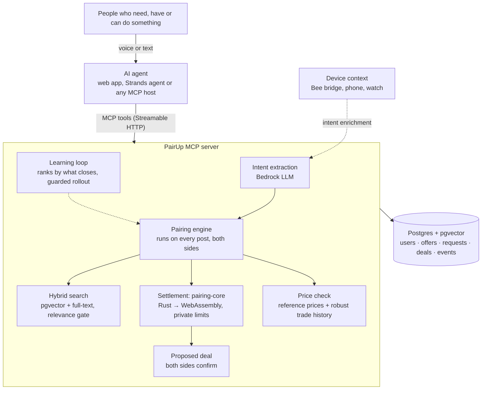

# PairUp: a peer-to-peer marketplace that AI agents run

People say what they need, what they have or what they can do. Their AI agent
finds the match, a fixed open-source rule settles the price inside limits each
side set privately, and both people give a final yes. It works for things and
for services: a spare calculator, a lunch run, a helper for Saturday.

PairUp is a [Model Context Protocol](https://modelcontextprotocol.io) (MCP)
server (spec 2025-11-25, Streamable HTTP), so any compatible AI agent can
connect to it. It is live on AWS with Amazon Bedrock.

**Try it:** https://d3cxpkmhl89rw9.cloudfront.net/app/ · MCP endpoint `https://d3cxpkmhl89rw9.cloudfront.net/mcp` (OAuth 2.1)

**Agents don't haggle.** Bargaining turn by turn costs model calls on every deal,
and a model can be talked into revealing a limit. One deterministic rule,
published as [pairing-core](https://github.com/rairurairu/pairing-core), sets
every price instead. [How a price is set](#how-a-price-is-set-no-haggling).

**Market:** set up for the University of Washington campus in Seattle (U District,
Capitol Hill, Fremont, Ballard, Northgate), in US dollars and Pacific time.

## The idea in one minute

Getting something from another person today means photos, forms, haggling in
chat and arranging a meet-up. Getting a small job done means a platform that
adds its own fees on top. That effort and cost decide what happens: a spare
calculator rarely finds the neighbor who needs it, and nobody pays a delivery
app to carry a $5 lunch two buildings over.

PairUp pairs buyers and sellers directly and does the work in between,
for things and for services. Both sides post what they have, what they can do,
or what they need:

- **Things:** "Sell my TI-84 for $20. I'll take anything above $15." · "I need a graphing calculator today, max $18." → "Found it: TI-84 Plus graphing calculator for $18, $2 below asking. Meet-up: UW campus. Should I confirm it?"
- **Errands and delivery:** "Find someone to pick up my lunch from the HUB to McCarty Hall by 12:30, $5." → a student already doing lunch runs on campus takes it for $4, and the fee goes to the person who walks.
- **One-time jobs:** "Get me a helper for the event on Saturday 2-6pm, budget $10 an hour." → "Found someone: Priya can do it for $10 an hour, $40 for 4 hours."

Neither side ever sees the other's limit. The MCP server understands both
requests, pairs each request with the best-fitting offer of the same kind,
settles the price and records the deal; the person's AI agent holds the
conversation; each person just says yes or no.

## Why it matters

- **Faster and cheaper.** One sentence reaches the person
  nearby who has it, and the deal closes the same day at a hand-off point. A $20
  TI-84 sells for $18: the seller keeps all $18, where a resale site's 13–20%
  commission would leave $16–17 after the buyer paid $20 plus shipping.
- **A small business in one sentence.** 72.9 million Americans already earn on their own,
  and 30% of adults under 30 have done gig work. On PairUp, opening a small
  business takes one sentence ("I do lunch runs from the HUB, $4"), the price is
  the seller's, the full price reaches the seller, and ratings and learned routines bring
  customers back.
- **Open to any personal agent.** Any MCP agent connects, an open-source rule
  sets every price, and every deal ends with a person's yes.
- **Built for the hard deals.** A one-of-a-kind item, a one-off job, a need nobody
  else lists: two private limits set the price, and an open request waits for the
  right person.

The seller always keeps the full price. PairUp earns from optional protected
online payment (a small buyer fee, held until the hand-off), paid agent access,
community licenses and Amazon referrals. Details: [the business case](research/PairUp-Business-Case.pdf).

Households hold about $3,000–4,000 of resellable items each, and 80% of discarded
furniture goes to landfill. Evidence, sources and the model's inputs:
[research/](research/README.md) (the [business case PDF](research/PairUp-Business-Case.pdf), the [short read](research/IMPACT_PLAIN.md), the [full evidence](research/IMPACT.md) and [the papers](research/LITERATURE.md)). The range of markets and one student's year:
[docs/USE_CASES.md](docs/USE_CASES.md).

## How a price is set: no haggling

The rule lives in
[pairing-core](https://github.com/rairurairu/pairing-core) (Rust compiled to WebAssembly):

- **The asking price is public.** A budget at or above it pays the ask.
- **A budget below it is the buyer's offer**, and the seller's private minimum
  decides whether it is accepted, like "best offer" with automatic acceptance.
- **The seller's minimum stays secret.** It never moves the price, so a deal
  shows only that the minimum was at most the price. A buyer who walks away
  from an offer never gets that listing cheaper later, so declining and asking
  again lower can't find the minimum.
- **One offer below the asking price per buyer and listing.** After a no, the
  asking price stands for that buyer ("The seller can't go that low. It's $20.
  Want it at that price?"), so stepping a budget up from below can't find the
  minimum either. Every other buyer still gets their own first offer.
- **The buyer's budget stays secret whenever it covers the ask.** A lower budget
  is the buyer's offer, so the seller sees it as the price.

**Price check.** A price far from what similar things go for gets a "did you
mean…?" before it is posted: a $1 iPhone, a minimum misheard as $1, a budget
heard as $180 for an $18 calculator. The typical range comes from reference
prices (curated estimates for the UW market), or from the market's own confirmed
trades. Those trades are counted so that staged ones barely move the range: one
vote per seller, at least three independent sellers and buyers, accounts older
than a week, a median-based range. A buyer who is offered something far below
the usual price hears a safety note. The check never sets or blocks a price;
it only asks.

## Learning from outcomes

Every proposed deal records what the engine saw (relevance, same area,
urgency, delivery offered, pre-approved seller, condition margin, price against
the typical range, each side's track record), and its outcome is the label.
Each night ([learning.ts](src/market/learning.ts)) a small logistic model is
trained on older outcomes and judged on the newest ones. It replaces the
current ranking only if it ranks them better. 10% of requests always keep the
hand-tuned ranking as a live control, and the model rolls back automatically
if its mutual-confirmation rate falls behind. The model only reorders candidates that
already pass every hard constraint, and prices stay with the fixed rule. The
dashboard shows daily mutual confirmation and both arms. The learning label
is mutual confirmation: both people said yes.

`npm run simulate` runs the real engine on simulated buyers who prefer nearby,
delivered and pre-approved offers; the engine is never told. Over 12 simulated
days the learned ranking closed 77% of its proposals against 59% for the
control, and it named delivery and same area as the main drivers. The buyers
are simulated, so this tests the learning loop itself; the campus pilot will measure real people.

## Service scheduling

Service requests accept natural schedules such as `Saturday 2-6pm`, or exact
`starts_at` / `ends_at` timestamps with offsets. Each post has an IANA `time_zone`
(default `America/Los_Angeles`), independent of the server's clock. The whole work
window must fit the provider's stated availability; a Sunday-only helper is not
proposed for a Monday job. Checks apply to both posting directions and direct
alternative selection. Timed reservations cannot overlap across a provider's
different offers, including when requests arrive concurrently.

The deterministic parser supports weekday names/ranges, weekdays/weekends,
explicit clock ranges, overnight windows and semicolon-separated shifts. Vague
phrases such as `evenings`, missing duration or unsupported exceptions stay
**tentative** and require the provider's explicit yes, even on an auto-accept
offer. Deadline-only errands cannot prove how long the work takes. Ambiguous DST
times require an explicit offset. See [the scheduling contract](docs/TOOL_CONTRACT.md#service-scheduling).

## Suggestions

PairUp learns regular requests from your own history and offers them shortly before they are due. Device context can also suggest an errand or item: to-dos and need snippets through the Bee bridge, and phone arrival signals. The For you dock above the composer shows one suggestion at a time, with Find it (Ask now when the budget is known), Not now or Forget. The Devices panel issues device tokens for a watch, a phone or the Bee bridge; /watch/ provides a compact voice view. The included Bee replay uses labelled sample data. See [Apple Watch](docs/APPLE_WATCH.md) and [Bee](docs/BEE.md). `npm run seed -- --lifestyle` adds three weeks of labelled sample lunch runs (the HUB → McCarty Hall, about $4, around 12:15) for `u_tony`.

Lifestyle code: src/market/lifestyle.ts and context.ts; device tokens: src/auth/devices.ts and src/http/devices.ts; voice loop: src/agent/runner.ts; browser: src/web/watch.ts and lifestyle-ui.ts; Bee bridge: scripts/bee-bridge.ts.

## PairUp Points with Ring

A PairUp Point is an unstaffed hand-off spot watched by one Ring doorbell. The
two people in a deal pick a point (`list_meetup_points`, `choose_meetup_point`),
then each presses the doorbell and says "I'm here" (`check_in_at_point`).
PairUp reads the point device's Event History through the Ring Partner API
(`api.amazonvision.com`) and accepts HMAC-signed Ring webhooks at
`POST /api/ring/webhook`. When Ring has confirmed both arrivals, the deal card
shows "both here". PairUp keeps only the event type and time, for 24 hours, and
never requests video. The integration is exercised with the Ring Playground and
signed simulated webhooks; the points in `data/pairup-points.json` are sample data.

| Variable | Use |
|---|---|
| `RING_ACCESS_TOKEN` | Partner API bearer token (a Playground token lasts 30 minutes) |
| `RING_API_BASE` | API base URL, default `https://api.amazonvision.com` |
| `RING_HMAC_KEY` | Webhook signing key; turns on `/api/ring/webhook` |
| `RING_POINT_DEVICES` | Points to devices, e.g. `pt_uw_hub=<device id>` |
| `RING_SANDBOX` | `true` counts Playground live-view simulations as arrivals |

```bash
npm run ring:probe     # lists your Ring devices and recent events, prints the RING_POINT_DEVICES line
npm run ring:simulate  # sends a signed test Ring webhook to the local server
```

Code: src/ring/ (client, webhook), src/market/points.ts. Details:
[docs/TOOL_CONTRACT.md](docs/TOOL_CONTRACT.md#pairup-points-ring).

## Delivery

Item deals change hands at an Amazon Hub point, or the buyer can have the item delivered. The deal card shows "Deliver to my locker" with the fee, and a buyer can say "deliver it" or "send it to my locker". The deal routes the item from an Amazon Hub Counter near the seller to an Amazon Hub Locker near the buyer, and neither sees the other's address. Hub points and fees are sample data, as with PairUp Points. The price stays the settled one; the fee is added to the total. See [Delivery](docs/DELIVERY.md).

## Run it (2 minutes, no database or AWS needed)

```bash
npm install
npm run reset        # create tables + load seed listings
npm start            # web app on http://127.0.0.1:3000/, MCP server at /mcp, operations dashboard at /dashboard/
npm run smoke        # (second terminal) plays the TI-84 deal end to end over real MCP
npm run check:release # read-only comparison of the running release and this checkout
npm test             # 175 unit + end-to-end tests (in-memory Postgres + pgvector)
npm run simulate     # the learning loop on a simulated market, day by day
cd agents/agentcore && npm install && npm test   # the Strands agent against a real server
```

Local dev uses **PGlite** — real Postgres + **pgvector** embedded in Node,
stored in `.data/`. Set `DATABASE_URL` to switch to a hosted Postgres.
`AI_MODE=mock` (default) works offline; `AI_MODE=bedrock` uses Amazon Bedrock.
See [.env.example](.env.example).

## The web app

`/app/` is a complete PairUp client for phones, laptops and smart displays:
talk or type, see each offer as a card, and confirm or decline with a tap.
It uses the MCP server the way a voice assistant such as Alexa+ would, so it
simulates the Alexa+ conversation in any browser:

- **It is an MCP host.** The browser runs a real MCP client: `tools/list` to
  discover tools, `tools/call` over Streamable HTTP with the signed-in user's
  token, `resources/read` for the view.
- **It renders MCP Apps.** Every result names the `ui://pairup/market.html`
  view; the app draws it in a sandboxed iframe through the MCP Apps bridge, and the
  card's Confirm / Decline / "Get this one" buttons call tools through the host.
- **The reasoning step runs on the server** (`/api/agent`): Amazon Bedrock tool use
  when `AI_MODE=bedrock` and a model is set, otherwise an offline planner that
  covers the whole voice flow. Either way a deal is only confirmed after the
  user's explicit yes.
- **Sign-in** is OAuth 2.1 with PKCE as a public client (`AUTH_MODE=oauth`) and
  supports Login with Amazon. Local development and the hosted app use a name and
  a passcode that the first sign-in with that name sets.
- **Offers that arrive while you're away** show up as a badge and a card, and are
  read out when voice is on.

Voice uses the browser's speech recognition and synthesis (Chrome, Edge, Safari);
typing works everywhere.

## Architecture



| Layer | Role |
|---|---|
| AI agent (any MCP host) | Interface and agent: conversation, confirmation. The web app is one; it simulates the Alexa+ conversation |
| MCP server (this repo) | Pairing intelligence: posts, matching, settlement, price checks, learning, deals |
| Device context (optional) | Ambient context → proactive buy requests |

## MCP tools

| Tool | What it does |
|---|---|
| `post_offer` | Offer an item to sell or a service you can do (per job or per hour): public price, **private minimum**, area. Pairs with a waiting request in the same call |
| `post_request` | Ask for an item or for help (pickup, drop-off, time, hours) + **private budget**. Pairs with the best offer and settles the price in the same call; returns alternatives |
| `find_matches` | More options for a request |
| `negotiate` | Take a different option instead; replaces the current deal |
| `confirm_deal` / `decline_deal` | Each side's yes or no; a no re-pairs both posts |
| `get_deal_status` | Deals and jobs waiting for your yes first, with counterpart, place and time |
| `list_my_posts` / `withdraw_post` | Your offers and requests; take one down, releasing any deal it held |
| `rate_deal` | 1 to 5 stars for the other side of a confirmed deal, once per side; feeds the track records the ranking learns from |
| `report_user` | Report the other side of a deal or the owner of an offer; the two are never paired again, and enough reports put someone under review |
| `get_suggestions` / `accept_suggestion` / `dismiss_suggestion` | Private suggestions; accept after yes, skip for now or forget a routine |
| `add_context` / `get_my_routines` | Bring a need snippet from Bee or a device; explain what was learned from your own history |
| `list_meetup_points` / `choose_meetup_point` / `check_in_at_point` | PairUp Points: pick a Ring-watched hand-off spot, then "I'm here" with Ring confirming each arrival |
| `delete_my_data` | Erase data after explicit confirmation, releasing holds and anonymizing retained counterpart deal records |

Weapons, drugs, alcohol and tobacco, prescription medicine, recalled and
counterfeit goods, fake documents, cheating, adult services, live animals and
illegal services can't be posted, as items or as services: a keyword policy plus
an embedding match against [data/policy.json](data/policy.json) refuses them
before anything is stored, with a spoken `say` and an error `code`.

Every tool declares an output schema and annotations, and every write takes an
optional `idempotency_key` so a retried call never posts or confirms twice. Deals nobody answers expire (by the request's deadline at the latest)
and both posts are paired again; per-user posting limits and per-caller rate limits
protect the market. Pairing rules, schemas, limits and privacy rules:
[docs/TOOL_CONTRACT.md](docs/TOOL_CONTRACT.md).

## Built for agents

Any MCP host or agent framework can find PairUp, learn it and use it safely
without a human wiring it up:

| | |
|---|---|
| **Connect without setup** | Any MCP client that follows the 2025-11-25 authorization spec connects to the hosted `/mcp` on its own: a Client ID Metadata Document (MCP 2025-11-25) or dynamic registration (RFC 7591), then a consent screen that names the client before sign-in. Tokens refresh with rotation and revoke at `/oauth/revoke` (RFC 7009). [docs/TOOL_CONTRACT.md](docs/TOOL_CONTRACT.md#connecting-a-client) |
| **Agent Skill** | [skills/pairup/SKILL.md](skills/pairup/SKILL.md), in the open SKILL.md format and served at `/skills/pairup/SKILL.md`: which tool for which sentence, how to read a deal, the rules, error codes, a worked example |
| **Server card** | `/.well-known/mcp/server-card.json`: endpoint, auth, instructions, and every tool, prompt and view with schemas, read from the live server |
| **llms.txt** | `/llms.txt`: the same in Markdown, with the rules an agent must follow |
| **Prompts** | `sell_something`, `find_something`, `whats_new` show up as starters in any host that supports MCP prompts, such as the MCP Inspector |
| **Safe retries** | `idempotency_key` on every write; a retry returns the first result |
| **Speakable errors** | Every result and error has a `say` sentence; errors an agent can act on carry a `code` |
| **Strands + AgentCore** | [agents/agentcore](agents/agentcore): a Strands Agents voice agent on Amazon Bedrock AgentCore Runtime whose only tools are this server's, with a code-level guard that blocks `confirm_deal` until the user says yes |

## Deployment and operational support

- **AWS:** CloudFront (HTTPS, HTTP/3, security headers) → EC2 Graviton with an IAM
  role (no access keys), encrypted EBS with daily snapshots, auto-recovery, deploys
  through Systems Manager with atomic release switching. [docs/DEPLOY.md](docs/DEPLOY.md)
- **Observability:** JSON logs in CloudWatch with a request id per call (`X-Request-Id`),
  CloudWatch metrics for MCP latency, tool failures and 5xx, alarms published to an SNS topic,
  Embedded Metric Format for per-tool latency.
- **Reliability:** `/ready` checks the database before traffic switches; graceful
  shutdown drains calls in flight; holds expire and re-pair on a timer; Bedrock
  intent/agent failures fall back to local parsing and the offline planner.
- **Safety:** OAuth 2.1 with PKCE (Login with Amazon supported as an identity provider),
  token revocation, SSRF-guarded client metadata fetches, Origin validation, CDN-only origin, per-caller rate
  limits, per-user posting limits, bounded inputs, private limits redacted in one
  place and leak-tested.
- **Trust and safety:** a prohibited and restricted items and services policy
  checked before every post, reports with a review queue on the dashboard, and
  ratings that feed each person's track record.
- **Speed:** `npm run bench` measures real MCP tool latency and throughput.
- **Tests:** unit and integration checks over MCP/HTTP, OAuth, schemas, privacy,
  idempotency, schedule compatibility, overlapping bookings and concurrent approvals;
  PairUp Points with Ring (client, presence rule, webhook signature, two-person check-in);
  175 tests in `npm test`, plus scripted Strands conversations against a real server. CI runs on every push.

## Repo map

```
src/
  index.ts               entry point
  app.ts                 HTTP: /mcp (Streamable HTTP), /api/agent, /api/me, /health, /api/dashboard, /api/review, OAuth routes
  auth/oauth.ts          OAuth 2.1 account linking (PKCE, protected-resource metadata)
  mcp/server.ts          MCP tool definitions
  mcp/schemas.ts         output schemas for every tool
  mcp/prompts.ts         MCP prompts (sell_something, find_something, whats_new)
  mcp/discovery.ts       server card and llms.txt, read from the live tool list
  mcp/apps.ts            the MCP Apps view (ui://pairup/market.html)
  agent/                 the web app's assistant step: Bedrock tool use, offline planner, confirm guard
  market/pairing.ts      pairing engine: pair on every post, atomic holds, release and re-pair
  market/scheduling.ts   deterministic availability, time zones and overlapping work windows
  market/matching.ts     hybrid pgvector + full-text search in both directions
  market/negotiation.ts  price settlement via pairing-core (Rust → WebAssembly)
  market/pricing.ts      price check: reference prices, robust trade-history range
  market/learning.ts     learning to pair better: features, model, guarded rollout
  market/policy.ts       what may be posted: keyword rules + embedding match (data/policy.json)
  market/trust.ts        reports, review status and the review queue
  market/amazon.ts       hand-offs to Amazon: search fallback, Trade-In, Hub meet-up points, Hub delivery
  market/points.ts       PairUp Points: registry, check-ins, Ring arrival matching, purge
  market/service.ts      business operations behind each tool
  market/views.ts        the only place rows become output (privacy redaction)
  market/idempotency.ts  retry-safe writes (idempotency_key)
  http/log.ts            JSON logs, CloudWatch Embedded Metric Format, request ids
  ring/                  Ring Partner API client (devices, Event History) and webhook signature check
  ai/                    mock + Bedrock embeddings and intent extraction
  db/                    PGlite / Postgres client, schema, seeding
src/web/                 the web app: OAuth PKCE sign-in, MCP client, MCP Apps host, voice
src/apps/                the MCP Apps view (deal card, options, deals, posts)
public/app/              web app shell + built bundle (npm run build:web)
public/mcp-apps/         built single-file MCP Apps view
public/dashboard/        operations dashboard
data/policy.json         prohibited and restricted items and services
data/seed-listings.json  seed market: 162 posts from 22 people, items and services; sample Amazon Hub points per area
data/trade-in-categories.json  categories Amazon Trade-In takes
data/pairup-points.json  sample PairUp Points (Ring hand-off spots)
skills/pairup/     the Agent Skill (SKILL.md)
agents/agentcore/        Strands Agents voice agent for Amazon Bedrock AgentCore Runtime
scripts/                 seed, smoke test, latency benchmark (bench.ts), Ring probe and webhook simulator, asset builds
research/                impact evidence, papers, plain-language summary
docs/                    use cases, tool contract, design system, deploy, validation, hackathon submission materials
vendor/pairing-core/     prebuilt module from https://github.com/rairurairu/pairing-core (refresh: node scripts/sync-pairing-core.mjs)
Dockerfile, deploy/      container image, AWS CloudFormation + deploy scripts, Lightsail config
```

## Spec conformance

- MCP 2025-11-25 Streamable HTTP: foreign Origin returns 403; unsupported protocol versions return 400; POST requires JSON and SSE Accept types and exactly one message. Arrays are rejected with 400/-32600.
- Initialized sessions support GET SSE and DELETE; unknown or expired sessions return 404. Stateless GET/DELETE returns 405. The browser reinitializes after session loss and retains write retry keys.
- Agent Skill: real YAML parsing validates allowed fields, directory/name agreement, description limits, metadata and references; a live tool-list test checks coverage. The format has no standard HTTP discovery path; the documented /skills endpoint remains in the server card and llms.txt.
- MCP Apps: SDK initialization/auto-resize, host theme variables/fonts, safe-area padding, inline/fullscreen/pip layout and bounded initialization cleanup. Audited with the official MCP Apps Agent Skill.
- Official MCP Inspector headless tools/list succeeds locally: zero schema portability errors. Focused spec tests supply additional coverage. See [resource audit](docs/RESOURCE_AUDIT.md) and [validation](docs/VALIDATION.md).

For local previews, append ?theme=light or ?theme=dark to /app/; the watch screen keeps its dark palette. The [two-device page](public/app/demo.html) runs both sides of a deal in separate sessions.

Ring references: [canonical starter](https://github.com/AmazonAppDev/ring-api-helloworld), [API](https://developer.amazon.com/docs/ring/api-documentation.html), [UX guide](https://developer.amazon.com/docs/ring/ux-design-guide.html). The client uses the same origin/Bearer/JSON:API model and adds bounded retries, pagination and signed request-id dedupe.

## Release

Release `v0.8.0` is deployed at `6895b52`: one design across the app, cards, watch and dashboard; Ring arrivals on the watch; audited transport, Skill and SDK integrations. `npm run check:release` confirms that the hosted endpoint runs this exact commit; public commit, asset and readiness checks pass. [Validation](docs/VALIDATION.md) lists every check, and [the campus pilot plan](docs/USER_VALIDATION.md) is the next step. [Live evidence](docs/EVIDENCE.md) records the AWS runtime results. The collector requires successful Bedrock inference, checks deployed commit/assets and redacts the token. Recollect after application changes with `npm run evidence -- --url <public-origin>` and `PAIRUP_TOKEN` in the environment; add `--agentcore-arn` for the hosted runtime.

## Amazon Developer Hackathon 2026

PairUp was built for the Amazon Developer Hackathon 2026 (Alexa+ track, with the
AWS Builder and Open Source mini challenges). Notes on the Amazon developer tools:
[per-tool feedback](docs/PRODUCT_FEEDBACK.md), [friction log](docs/FRICTION_LOG.md),
[feature requests](docs/FEATURE_REQUESTS.md).

## License

MIT — see [LICENSE](LICENSE).
